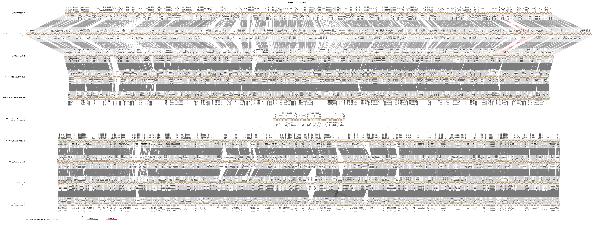

# bactviz

**linear genome alignment maps** for bacterial genomes coming from MAGs and Metagenomes: MUMmer collinear blocks between stacked genomes, every annotated gene drawn as an arrow, and gene names placed above/below the arrows. Output is SVG.

```
bactviz - linear genome alignment maps for bacterial genomes (MUMmer + gene annotations)

Gaurav Sablok
gsablok@proton.me

USAGE:
    bactviz [OPTIONS] <GENOME>...

Genomes (GenBank or FASTA; multi-record files = chromosome + plasmids/contigs) are drawn top to
bottom in the order given. Each genome is aligned to the one above with MUMmer (nucmer).
Requires MUMmer on PATH (conda install -c bioconda mummer | apt install mummer).

OUTPUT:
    -o, --output <FILE>       output SVG                              [chloroviz.svg]
        --tsv <FILE>          also write all blocks as a TSV table
        --title <TEXT>        figure title
        --names <A,B,...>     override genome labels (comma separated, one per genome)
        --width <PX>          figure width                            [1800]
        --align <center|left> track alignment                         [center]
        --vmin <PCT>          lower bound of the identity colour scale [auto]

GENES:
        --no-genes            do not draw gene arrows
        --labels              label every gene that has a symbol (as many as fit). + strand genes
                              are named above the track, - strand genes below, with a leader line
        --label-genes <A,B>   always label these gene symbols (e.g. dnaA,gyrB,rpoB)
        --label-size <PX>     label font size                         [8]
                              Tip: gene names only fit when zoomed in - use a big --width
                              (SVG is vector; e.g. --width 12000) or --label-genes.

BACTERIAL OPTIONS:
        --start-gene <NAME>   re-orient and rotate the largest replicon of each genome so this gene
                              (usually dnaA) starts at position 1 on the + strand
        --min-record <BP>     ignore records/contigs shorter than this [0]

MUMMER OPTIONS:
        --minmatch <N>        nucmer -l  minimum exact match          [20]
        --mincluster <N>      nucmer -c  minimum cluster length       [65]
        --match-mode <M>      mumreference | mum | maxmatch           [mumreference]
        --one-to-one          run delta-filter -1 (one-to-one alignments)
        --min-length <BP>    drop alignments shorter than this        [1000]
        --min-identity <PCT>  drop alignments below this identity     [0]
        --mummer-dir <DIR>    directory containing nucmer/show-coords/delta-filter
        --keep-temp           keep intermediate MUMmer files

    -h, --help                show this help

```


```bash
# needs MUMmer on PATH:  conda install -c bioconda mummer   (or apt install mummer)
./target/debug/bactviz gb/*.gb --start-gene dnaA --labels --width 6000 --title "Rhizobium strains" --tsv blocks.tsv -o rhizobium.svg
```




Genomes (GenBank or FASTA) are stacked top to bottom in the order given; each is aligned to the
one above with `nucmer` (+ optional `delta-filter -1`, then `show-coords -T -H -l`), exactly the
pyGenomeViz MUMmer pipeline. Order genomes by phylogeny for the clearest figure.

## What it draws
* **Links**: grey = forward collinear blocks shaded by identity; red twisted ribbons = inversions.
* **All genes**: one arrow per gene, from `CDS`, `tRNA`, `rRNA`, `tmRNA`, `ncRNA`, `misc_RNA`, plus
  gene-only features (pseudogenes, unannotated genes; grey). Duplicate `gene`+`CDS` pairs are
  merged, and the gene symbol is copied to the CDS. + strand arrows sit in the upper half of the
  track, - strand arrows in the lower half. Hover any arrow (SVG tooltip) for name / locus tag /
  product / coordinates.
* **Gene names**: `--labels` names every gene with a symbol, *above* the track for + strand genes and
  *below* for - strand genes, rotated 90 degrees, with a leader line to its arrow and a white halo
  so it stays readable over the ribbons. Labels never overlap (greedy packing). At whole-genome
  scale only the names that fit are shown, so use a large `--width` (vector output, e.g. 12000) or
  `--label-genes dnaA,gyrB,rpoB` to force specific names.
* **Multi-record genomes**: chromosome + plasmids or draft contigs are laid side by side in one
  track; MUMmer handles the record-to-record matching.

## Bacterial specifics
* `--start-gene dnaA` reverse-complements (if needed) and rotates the largest replicon of every
  genome so dnaA starts at position 1 on the + strand, aligning origins and strands before MUMmer.
* `--min-record N` drops tiny contigs; `--min-length` / `--min-identity` filter alignments.
* Mb-scale axis and scale bar.

## MUMmer options
`--minmatch` (nucmer -l, 20), `--mincluster` (-c, 65), `--match-mode mumreference|mum|maxmatch`,
`--one-to-one` (delta-filter -1), `--mummer-dir`, `--keep-temp`.

## Notes
* Nucleotide alignment only (nucmer). For distant genomes, lower `--minmatch` or use a smaller
  `--mincluster`.
* Convert to PNG/PDF with `rsvg-convert` or Inkscape.

## Notes on real-world GenBank files
* Not every record carries `/gene=` symbols (some NCBI/INSDC submissions only have `locus_tag`).
  `--start-gene` and `--labels` fall back to `locus_tag`, then to a word match inside `/product=`,
  so e.g. `--start-gene dnaA` still finds a CDS annotated only as
  `/product="chromosomal replication initiator protein DnaA"`.
* A collinear block that is short relative to genome length (e.g. an rRNA operon on a multi-Mb
  chromosome) is real but can be a near-invisible hairline in a shrunk PNG preview; it is still
  there in the vector SVG at full/zoomed resolution, and link ribbons have a small minimum drawn
  width so they survive rasterization too. When in doubt, check the TSV block table, or open the
  SVG in a browser and zoom in.
